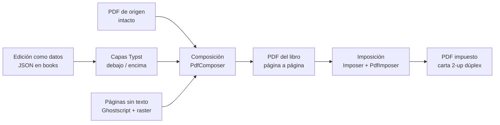
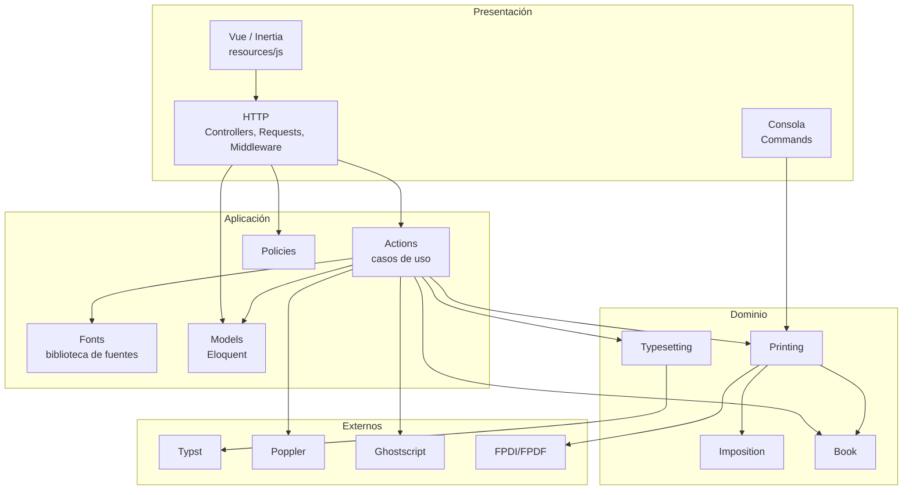
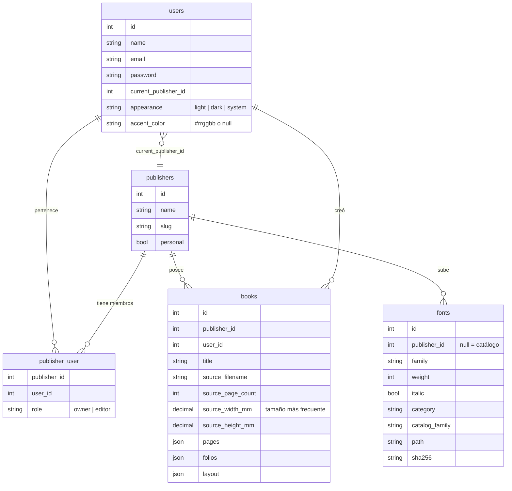
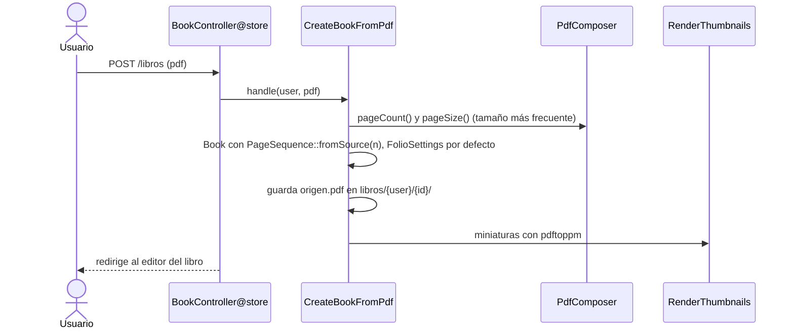
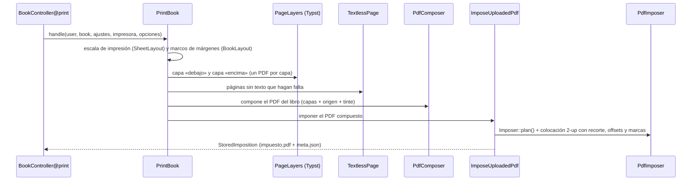

# Arquitectura de Noctua

Este documento explica **cómo está construido Noctua y por qué**. Para el detalle de cada archivo, ver [backend.md](backend.md) y [frontend.md](frontend.md).

---

## 1. Visión en una frase

Noctua toma un **PDF de origen que nunca modifica**, guarda la edición del usuario **como datos** (orden de páginas, fondos, cuadros de texto, numeración, márgenes) y, al imprimir, **compone** un PDF nuevo apilando capas sobre las páginas originales y lo **impone** en hojas carta apaisadas, dos páginas por cara, listas para doblar en cuadernillos y coser.



---

## 2. Pila tecnológica

| Capa                    | Tecnología                                                        | Papel                                                                         |
| ----------------------- | ----------------------------------------------------------------- | ----------------------------------------------------------------------------- |
| Servidor                | Laravel 13, PHP 8.4                                               | Rutas, autenticación, persistencia, orquestación de procesos                  |
| Interfaz                | Vue 3 (Composition API, `<script setup>`), TypeScript, Inertia 3  | Páginas reactivas sin API REST separada                                       |
| Estilos                 | Tailwind CSS 4, componentes shadcn-vue (reka-ui)                  | Diseño, modo claro/oscuro, color de acento                                    |
| Editor de texto         | TipTap 3                                                          | Texto enriquecido dentro de cada cuadro (negrita, cursiva, color por palabra) |
| Composición tipográfica | Typst 0.15                                                        | Dibuja fondos, cuadros de texto, rectángulos y folios como PDF vectorial      |
| PDF                     | FPDI 2.6 + FPDF 1.9                                               | Importa páginas de PDF existentes y las coloca, recorta y apila               |
| Análisis de PDF         | Poppler (pdftoppm, pdftotext, pdftohtml)                          | Miniaturas, imágenes de página, extracción de texto con posición y estilo     |
| Quitar texto            | Ghostscript 10 (`-dFILTERTEXT`) + GD                              | Página sin su texto vectorial; borrado en imagen para escaneos                |
| Autenticación           | Laravel Fortify                                                   | Registro, login, verificación, 2FA, llaves de acceso (passkeys)               |
| Rutas tipadas           | Laravel Wayfinder                                                 | Genera funciones TypeScript para cada ruta y controlador                      |
| Base de datos           | SQLite en local; PostgreSQL previsto                              | Libros, espacios, fuentes, usuarios                                           |
| Calidad                 | Pest 5, Vitest, PHPStan (nivel máximo, Larastan), Pint, vite-plus | Tests, tipos, formato                                                         |

---

## 3. Capas y dependencias

La regla principal: **el dominio no conoce Laravel**. Las dependencias apuntan siempre hacia dentro.



| Capa             | Carpeta                    | Responsabilidad                                                                                                                                              | Depende de                                                                                |
| ---------------- | -------------------------- | ------------------------------------------------------------------------------------------------------------------------------------------------------------ | ----------------------------------------------------------------------------------------- |
| **Dominio**      | `app/Domain`               | Reglas del negocio expresadas en objetos inmutables: orden de imposición, geometría de la hoja, secuencia de páginas, diseño de página, extracción de texto. | Solo PHP, FPDI (impresión) y el binario de Typst (tipografía). Nunca Eloquent ni facades. |
| **Aplicación**   | `app/Actions`, `app/Fonts` | Casos de uso que combinan dominio, almacenamiento y binarios externos: crear un libro, imprimirlo, quitar el texto de una página.                            | Dominio, modelos, `Storage`, `Process`.                                                   |
| **Persistencia** | `app/Models`               | Modelos Eloquent. Guardan la edición como JSON y la convierten en objetos de dominio (`Book::sequence()`, `Book::folioSettings()`, `Book::bookLayout()`).    | Dominio (para hidratar).                                                                  |
| **HTTP**         | `app/Http`                 | Traducir peticiones en llamadas a acciones; validar; autorizar; preparar las props de Inertia.                                                               | Aplicación, modelos, políticas.                                                           |
| **Presentación** | `resources/js`             | Interfaz. No contiene reglas de impresión: lo que se ve en el editor es una aproximación; la «Vista exacta» pide al servidor el pliego compuesto de verdad.  | Rutas Wayfinder, props de Inertia.                                                        |

`tests/Unit/ArchTest.php` vigila estas reglas en cada ejecución de los tests:

- `App\Domain\Imposition` solo puede usar su propio espacio de nombres y `InvalidArgumentException` (lógica pura).
- `App\Domain` no puede usar `Illuminate`, `App\Models` ni `App\Http`.
- `App\Domain` no puede contener `dd`, `dump`, `ray` ni `var_dump`.

---

## 4. Patrones de diseño

### 4.1 Objetos de valor inmutables (`final readonly class`)

Todo el dominio usa clases `final readonly`: `Size`, `Offset`, `PageItem`, `PageSequence`, `TextBox`, `ImpositionSpec`… Se validan en el constructor y lanzan una excepción de dominio propia (`InvalidImpositionSpec`, `InvalidPageSequence`, `InvalidPageDesign`, `PageDoesNotFit`). Un objeto que existe es un objeto válido.

### 4.2 Acciones (casos de uso)

Cada operación de negocio es una clase con un método `handle()` (`CreateBookFromPdf`, `PrintBook`, `TextlessPage`, `ImposeUploadedPdf`, `CreatePublisher`…). Los controladores se limitan a validar, autorizar y llamar a la acción. Se inyectan por el contenedor de Laravel.

### 4.3 Edición no destructiva

El PDF de origen (`origen.pdf`) **nunca se modifica**. Todo lo que el usuario hace es JSON en la tabla `books`:

- `pages`: lista ordenada de `{id, source, folio, design}`. `source: null` es un blanco.
- `folios`: ajustes de numeración.
- `layout`: márgenes del libro.

Se puede deshacer todo, el original siempre está disponible y la impresión es reproducible.

### 4.4 Serialización explícita `toArray()` / `fromArray()`

Los objetos de dominio que se guardan (`PageDesign`, `BookLayout`, `TextBox`…) tienen `toArray()` y `fromArray(mixed)`. `fromArray` acepta cualquier cosa y valida, porque los datos vienen de JSON.

### 4.5 Composición por capas

Al imprimir, cada página se arma apilando, de abajo arriba:

1. Capa **debajo** (Typst): fondo de color «detrás».
2. **Página de origen** (FPDI), o su versión **sin texto** si el usuario hizo el texto editable, encajada en el marco de márgenes.
3. **Tinte** (FPDF con fusión _multiply_): fondo de color «teñido».
4. Capa **encima** (Typst): cuadros de texto, rectángulos y folios.

Typst compila todas las páginas de cada capa en un único PDF (una página por página del libro), lo que es mucho más rápido que compilar página a página.

### 4.6 Salida determinista

El mismo libro con la misma edición produce **los mismos bytes**:

- `DeterministicFpdi` fija la fecha de creación a la época Unix y elimina metadatos variables.
- Typst se ejecuta con `--creation-timestamp 0` y sin fuentes del sistema (`--ignore-system-fonts`).
- Las rutas temporales tienen nombres aleatorios pero no aparecen en la salida.

Así es posible comparar salidas en tests y cachear resultados.

### 4.7 Procesos externos aislados

Typst, Poppler y Ghostscript se ejecutan con `Symfony\Process`, con lista de argumentos (sin shell), con tiempo máximo (`noctua.process_timeout`) y, en el caso de Typst, con `--root` limitado a un directorio temporal. Las rutas a los binarios vienen de `config/noctua.php` y se inyectan en `AppServiceProvider` como singletons.

### 4.8 Cachés derivadas en disco

Lo que es caro y depende solo del PDF de origen se genera una vez y se guarda junto al libro: miniaturas, imágenes de página para el editor, páginas sin texto. Si se borran, se regeneran solas.

### 4.9 Multiespacio por columna

Cada recurso pertenece a un `Publisher` (espacio de trabajo) mediante `publisher_id`. Ver sección 6.

### 4.10 Inertia en lugar de API

No hay API REST separada. Los controladores devuelven `Inertia::render('pagina', props)`; Vue recibe las props ya tipadas. Solo hay tres endpoints JSON, usados por el editor de pliego: imagen de página, texto editable y vista exacta.

### 4.11 Rutas tipadas con Wayfinder

`php artisan wayfinder:generate --with-form` genera `resources/js/routes` y `resources/js/actions`. El frontend llama a `books.update(book)` en vez de escribir URLs a mano; si una ruta cambia, TypeScript lo detecta.

---

## 5. Modelo de datos



### Estructura del JSON `books.pages`

```json
[
    {
        "id": "p7",
        "source": 7,
        "folio": true,
        "design": {
            "background": { "color": "#fdf6e3", "mode": "behind" },
            "hide_source_text": true,
            "elements": [
                {
                    "id": "txt-7-ab12-1",
                    "type": "text",
                    "x": 8.97,
                    "y": 20.72,
                    "width": 97.71,
                    "height": 10.02,
                    "font": "Libertinus Serif",
                    "size_pt": 10,
                    "line_height": 1.32,
                    "color": "#000000",
                    "align": "justify",
                    "valign": "top",
                    "fill": null,
                    "spans": [
                        {
                            "text": "con afirmaciones ",
                            "bold": false,
                            "italic": false,
                            "color": null
                        },
                        {
                            "text": "teóricas",
                            "bold": true,
                            "italic": false,
                            "color": "#b00020"
                        }
                    ]
                },
                {
                    "id": "r1",
                    "type": "rect",
                    "x": 0,
                    "y": 0,
                    "width": 20,
                    "height": 10,
                    "fill": "#ffffff",
                    "opacity": 1
                }
            ]
        }
    },
    { "id": "b1", "source": null, "folio": false }
]
```

- Las coordenadas van en **mm desde la esquina superior izquierda de la página del libro**.
- `size_pt` es el cuerpo **en la página del libro**. Al imprimir, la página se escala (por ejemplo, ×0,62 para una carta en media carta) y todo escala con ella.
- `hide_source_text: true` hace que se use la versión sin texto de la página de origen.

### Estructura de `books.folios` y `books.layout`

```json
{
    "enabled": true,
    "first_numbered_page": 7,
    "start_number": 1,
    "position": "bottom-outer",
    "font": "Nunito",
    "size_pt": 12,
    "margin_mm": 10
}
```

`position` admite `bottom-center`, `bottom-outer` y `top-outer`. `first_numbered_page` es una posición del libro (1 = primera página), y `start_number` el número que lleva esa página.

```json
{
    "margin_top_mm": 15,
    "margin_bottom_mm": 18,
    "margin_inside_mm": 15,
    "margin_outside_mm": 12
}
```

Los tamaños de folio y los márgenes se expresan **como quedan impresos** (después de escalar la página a la hoja).

---

## 6. Multiespacio (multitenancy)

- **Inquilino = `Publisher`**. Hay dos tipos: el **espacio personal** (`personal = true`, uno por cuenta, creado al registrarse) y las **editoriales** compartidas.
- **Pertenencia**: tabla pivote `publisher_user` con rol `owner` o `editor` (`App\Enums\PublisherRole`).
- **Espacio activo**: `users.current_publisher_id`. `EnsureUserHasPublisher` garantiza en cada petición que el usuario tenga uno válido del que sea miembro y, si no, le asigna el primero o su espacio personal.
- **Aislamiento**: libros, fuentes subidas e imposiciones se filtran siempre por el espacio activo (`$user->publisher()`). Las políticas (`BookPolicy`) comprueban la pertenencia además del filtro.
- **Permisos**:

| Acción                                    | Editor            | Propietario |
| ----------------------------------------- | ----------------- | ----------- |
| Ver, editar e imprimir libros del espacio | Sí                | Sí          |
| Borrar un libro                           | Solo los que creó | Todos       |
| Subir y borrar fuentes del espacio        | Sí                | Sí          |
| Renombrar el espacio, gestionar miembros  | No                | Sí          |

- **Registro**: «Para mí» crea solo el espacio personal; «Para una editorial» crea además la editorial y la deja activa (`CreateNewUser`).
- **Escala futura**: el aislamiento por columna funciona para empezar. Si hiciera falta más aislamiento, el punto único para cambiarlo es el filtrado por `publisher_id`.

---

## 7. Almacenamiento en disco

Todo va en el disco `local` de Laravel (`storage/app/private`):

```
storage/app/private/
├── libros/{user_id}/{book_id}/
│   ├── origen.pdf                 PDF original, intacto
│   ├── miniaturas/{n}.jpg         Miniatura de cada página (editor de páginas)
│   ├── paginas/{n}.jpg            Página a 110 ppp (editor de pliego)
│   ├── paginas/{n}-sin-texto.jpg  Ídem, sin texto
│   └── sin-texto/{n}.pdf          Página sin texto (vectorial o rasterizada)
├── imposiciones/editorial-{publisher_id}/{ulid}/
│   ├── fuente.pdf                 PDF que se impuso
│   ├── impuesto.pdf               Resultado listo para imprimir
│   └── meta.json                  Ajustes, nombre, número de páginas, fecha
└── fonts/
    ├── catalogo/                  44 familias libres (noctua:fonts:install)
    └── editoriales/{publisher_id}/  Fuentes subidas por cada espacio
```

En los tests, `TestCase` sustituye el disco por uno falso (`Storage::fake('local')`), para que **ningún test toque archivos reales**.

---

## 8. Flujos principales

### 8.1 Crear un libro desde un PDF



El tamaño del libro es el **más frecuente** entre sus páginas, porque muchos PDF empiezan con una portada o una miniatura de otro tamaño. Las páginas de otro tamaño se encajan escaladas y centradas (`PdfComposer::fitInto`).

### 8.2 Editar páginas y guardar

1. `books/Edit.vue` mantiene en un `useForm` las páginas, los folios y los márgenes.
2. Reordenar, quitar, duplicar, insertar blancos o cambiar la numeración modifica ese estado en el navegador.
3. «Guardar» hace `PUT /libros/{id}`. `BookContentRequest` valida y construye `PageSequence`, `FolioSettings` y `BookLayout`; si algo no cumple las reglas del dominio, la excepción se convierte en un error de validación.

### 8.3 Editor de pliego y «Vista exacta»

- `SpreadEditor.vue` muestra dos páginas enfrentadas con la imagen de cada página (`GET /libros/{id}/paginas/{n}/imagen`) y encima los elementos como HTML, medidos en mm × escala de pantalla.
- La **Vista exacta** envía el estado sin guardar a `POST /libros/{id}/vista-previa` con las posiciones del pliego. El servidor compone solo esas páginas con el mismo código que al imprimir (`PrintBook::compose`, `only`), las rasteriza con pdftoppm a 80 ppp y devuelve imágenes en base64.

### 8.4 Hacer editable el texto original

```mermaid
sequenceDiagram
    actor U as Usuario
    participant E as SpreadEditor
    participant C as BookPreviewController@editableText
    participant X as ExtractPageText
    participant T as TextlessPage
    participant B as TextBlockBuilder
    U->>E: «Hacer editable el texto»
    E->>C: POST /libros/{id}/paginas/{n}/texto-editable
    C->>X: líneas con posición (pdftotext -bbox-layout) y estilo (pdftohtml -xml -hidden)
    C->>T: página sin texto (Ghostscript; si es escaneo, borrado en imagen)
    C->>C: encaja las líneas en la página del libro (escala y centrado)
    C->>B: agrupa líneas en párrafos → TextBox
    C-->>E: elementos + fuentes sustituidas
    E->>E: añade los cuadros y marca hide_source_text
```

**Libros escaneados**: en un PDF de escáner con OCR, el texto visible está dentro de una imagen y el texto del PDF es una capa invisible. `TextlessPage` compara la tinta de cada palabra antes y después de quitar el texto vectorial. Si no cambió, la palabra está en la imagen: rasteriza la página a 300 ppp y la borra pintándola con el color del papel de alrededor.

**Elección de fuente**: `FontMatcher` busca la familia del PDF entre las disponibles en el espacio. Si no está, elige la más parecida por categoría (serif, sans, manuscrita…) y lo comunica para que el usuario pueda subir la original.

### 8.5 Imprimir



### 8.6 Imposición

Para un cuadernillo de 4n páginas y la hoja i (1 = exterior):

| Cara   | Izquierda   | Derecha     |
| ------ | ----------- | ----------- |
| Frente | 4n − 2i + 2 | 2i − 1      |
| Dorso  | 2i          | 4n − 2i + 1 |

- El dorso supone dúplex con volteo por el **borde corto**.
- Si el número de páginas no es múltiplo del cuadernillo, se rellena con blancos o se acorta el último cuadernillo (`shortLastSignature`).
- El **creep** desplaza el contenido de las hojas interiores hacia el lomo un paso por hoja anidada.
- `SheetLayout` coloca cada página con el lomo pegado al doblez, centrada en vertical, **recortada a su media hoja**, y aplica los offsets de la impresora en cada cara.

---

## 9. Apariencia (modo y color de acento)

- Se guardan en el usuario (`appearance`, `accent_color`). Sin sesión, se usa la cookie `appearance`.
- `HandleAppearance` pasa a la plantilla Blade la clase `dark` y las variables CSS del acento (`AccentPalette::style`), para que la página **llegue ya pintada** y no parpadee.
- `resources/js/lib/accent.ts` replica el cálculo en el navegador para la vista previa en vivo. El color del texto sobre el acento es blanco o negro según el contraste (WCAG).

---

## 10. Decisiones de diseño (resumen)

| Decisión                                          | Motivo                                                                                                                                        |
| ------------------------------------------------- | --------------------------------------------------------------------------------------------------------------------------------------------- |
| Typst para la tipografía                          | Compila cientos de páginas en menos de un segundo, salida determinista, sintaxis legible y fácil de generar desde PHP (fase 0, `spike-0.md`). |
| FPDI para la imposición                           | Coloca páginas de PDF existentes como plantillas vectoriales con precisión de 0,03 mm, sin rasterizar.                                        |
| PDF de origen intacto + edición como datos        | Reversibilidad total, el original siempre disponible, reimpresión idéntica.                                                                   |
| Capas en PDF aparte en lugar de editar el PDF     | Escribir dentro del PDF de origen es frágil; superponer capas funciona con cualquier PDF.                                                     |
| Ghostscript a PDF 1.4 sin flujos de objetos       | El parser gratuito de FPDI no lee la compresión de objetos de PDF 1.5.                                                                        |
| Raster solo cuando hace falta                     | Las páginas sin texto se quedan vectoriales; solo los escaneos se rasterizan, a 300 ppp.                                                      |
| Tamaño del libro = tamaño de página más frecuente | La primera página suele ser una portada o miniatura de otro tamaño.                                                                           |
| Multiespacio por columna                          | Sencillo, suficiente para empezar y con un único punto de cambio.                                                                             |
| Interfaz en español en el propio código           | El público es hispanohablante; las cadenas de autenticación y validación están en `lang/es`.                                                  |
| Commits directos en `main`                        | Proyecto de un solo desarrollador; CI en cada push.                                                                                           |
